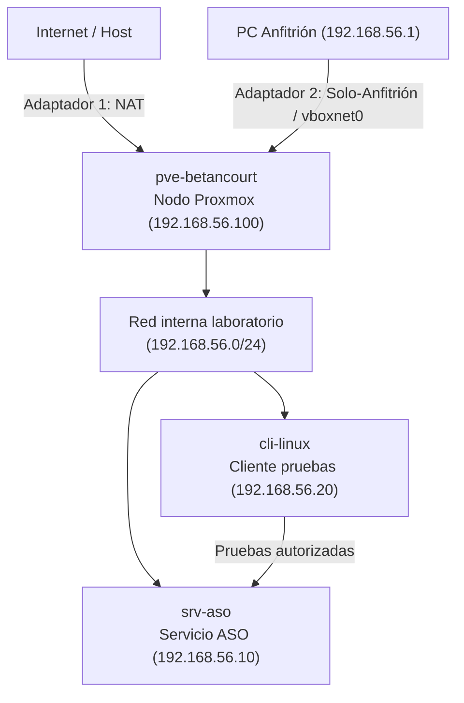

# 02-diagrama-red

## Objetivo
Diseñar la topología de red, el esquema de direccionamiento IP, los parámetros de pasarela/DNS y las medidas de aislamiento necesarias para el despliegue del entorno virtualizado en Proxmox VE 9.2-1.

## Procedimiento
1. **Definición de parámetros del nodo:** Asignación del nombre del hipervisor (`pve-betancourt`) y configuración del puente de red virtual principal (`vmbr0`) vinculado a la interfaz física del equipo.
2. **Esquema de direccionamiento IP:** Planificación de la subred de laboratorio (`192.168.56.0/24`) para alojar de forma estática el nodo, el servidor de servicios ASO y el cliente de pruebas.
3. **Definición de servicios y puertos:** Identificación de los puertos de gestión (`8006`, `22`) y establecimiento de las reglas de tráfico y aislamiento de red.

## Comandos usados

```bash
# Comprobar el nombre del hostname del sistema
hostnamectl

# Verificar las direcciones IP y el estado de las interfaces de red
ip -br addr

# Comprobar la versión exacta de Proxmox VE instalada
pveversion

# Verificar el espacio de almacenamiento disponible
df -h
```

## Evidencias
### Tabla de direccionamiento de red

| Elemento | Nombre | IP | Función | Recursos |
| :--- | :--- | :--- | :--- | :--- |
| **Nodo Proxmox** | `pve-betancourt` | `192.168.56.100` | Hipervisor / Gestión principal | 2 vCPU, RAM host, Disco virtual (30-40 GB) |
| **Servidor ASO** | `srv-aso` | `192.168.56.10` | Servicio principal (Servicios de Red / ASO) | 1 vCPU, 1 GB RAM, Disco virtual (10-20 GB) |
| **Cliente** | `cli-linux` | `192.168.56.20` | Pruebas de conectividad y validación | 1 vCPU, 512 MB - 1 GB RAM, Disco virtual (10 GB) |

* **Interfaz de gestión:** `vmbr0` (Puente de red asociado al hipervisor).
* **Red o VLAN de laboratorio:** Subred `192.168.56.0/24`.
* **Gateway (Puerta de enlace):** `192.168.56.1`.
* **DNS:** `8.8.8.8` / DNS del centro educativo.
* **Puertos necesarios:**
  * `8006 (TCP):` Interfaz web de administración de Proxmox VE.
  * `22 (TCP):` Acceso remoto seguro mediante SSH.
  * `53 (TCP/UDP), 80 (TCP):` Servicios estándar de red y web.

### Diagrama de red


## Incidencias
Ninguna incidencia registrada durante la fase de diseño lógico y planificación de red.

## Conclusion
El diseño de red y la asignación de direccionamiento IP se han completado, estableciendo una base sólida y estructurada mediante el bridge vmbr0 para proceder a la implementación virtual del nodo Proxmox y sus servicios.


[Volver al indice](../README.md)
